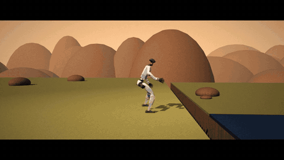

# Hi, I'm Ahmed Sleem 👋

### Robot learning engineer: I teach humanoids to move, then find exactly where they break.

<b>A Unitree G1 runs off a cliff, does three backflips across the gap, lands on the lower cliff and keeps running.</b> 
RL policy (PPO, MuJoCo/mjlab), 100 % strict success in evaluation, trained on a laptop RTX 3060.
Motors boosted to 2× torque (labelled; landing ~15 g).

  

---

## ⚡ What I do

- **Train** robot policies end to end: RL locomotion and whole-body control, imitation learning, vision-language-action models.
- **Break** them on purpose: shoves, payloads, latency, friction, weak motors, unseen objects, other physics engines.
- **Measure** properly: fixed seeds, confidence intervals, every failure tagged with its cause, scripted parts labelled as scripted.
- **Fix** the cause, not the symptom, and publish what didn't work too.

## 🤖 Selected work

| | Question | What I found |
|---|---|---|
|  | **[humanoidmujoco](https://github.com/ahmedsleem109/humanoidmujoco)**: the standard robustness recipe mixes random pushes with domain randomization. Which half does the work? | Three G1 policies, identical except for training disturbances, shoved **22,000 times**. Pushes raise the 50 %-recovery force from **337 N to 639 N**; domain randomization adds only **2.4 %**. |
|  | **[WorkshopRobot](https://github.com/ahmedsleem109/WorkshopRobot)**: *"bring me the 10mm wrench"*. Where does a language-commanded mobile manipulator (Go2 + Z1 arm) fail? | **125/125** grasps, **86 %** end to end. **8 of 10 failures are locomotion**, not manipulation. Fine-tuned SmolVLA grasps **18/20** on held-out scenes. |
|  | **[openarm-tray-carry](https://github.com/ahmedsleem109/openarm-tray-carry)**: two arms carry a tray with a loose ball on it, from camera images only. Does it survive a sim-to-real gap model? | **12/12** carries with noise, latency, backlash, weak motors and randomized dynamics all at once. Without the balancer: **1/12**. [Try it in your browser](https://ahmedsleem109.github.io/openarm-tray-carry/web/). |
| | **[Warehouse-humanoid](https://github.com/ahmedsleem109/Warehouse-humanoid-)**: a G1 carrying a 4 kg tote, planned by a small local VLM. Where does it break? | **0/64** falls at 4 kg. Breaks at **≥ 80 ms latency**, ≥ 400 N shoves and floor friction 0.1. Language → task success **80 %** on a 4-bit Qwen2.5-VL-3B. |
|  | **[RopePhysics](https://github.com/ahmedsleem109/RopePhysics)**: a rope and cable simulator (C++/CUDA) validated against textbook physics. Can a robot learn to route a wire harness in it? | Routing success **2 % → 85 %** in 129 s on the GPU; the learned motion routes **1024/1024** new cables, a hand-written one routes **0**. |
| | **[Baglens](https://github.com/ahmedsleem109/Baglens)**: can you trust a robot recording before you debug from it? | Finds silent recording gaps, stale data and broken transforms in robot logs (e.g. a real PX4 flight), with published precision and recall, and says *"unassessable"* when it can't tell. MCP server included. |
| | **[Jointly](https://github.com/ahmedsleem109/jointly-desktop-releases)**: CAD → simulation-ready robot models | Desktop app that turns STEP / SolidWorks / meshes into **URDF, MJCF (MuJoCo), SDF and USD** automatically. [jointlyapp.netlify.app](https://jointlyapp.netlify.app/) |

### 🔭 Building now: Foresight

A Unitree G1 with the real **Dex3-1 hands** follows language instructions in procedural rooms: walk, squat, **grasp with finger contact**, carry, place.
A fine-tuned **VLA** outputs whole-body commands to an RL whole-body controller, and a small **world model** imagines the next 1–2 s and **vetoes actions predicted to fall, collide or drop**.
Code and results will be released when the first claims are measured.

### 🧩 Open source

- [`unitreerobotics/unitree_rl_mjlab`](https://github.com/unitreerobotics/unitree_rl_mjlab/pulls?q=author%3Aahmedsleem109): dependency bounds that keep fresh installs working (PR open).
- [`selfpatch/ros2_medkit`](https://github.com/selfpatch/ros2_medkit/pulls?q=author%3Aahmedsleem109): fault debouncing by code, and keeping the numbers behind a diagnostic fault (PRs open).

## 🛠️ Toolbox

**Robots I've trained:** Unitree G1 (+ Dex3-1 hands) · Unitree Go2 + Z1 arm · OpenArm v2 (bimanual)

---

**BSc Mechatronics & Robotics, German University in Cairo** · All work above is in simulation (MuJoCo). 
Looking for **robot learning / RL / simulation** roles. **[Let's talk on LinkedIn →](https://www.linkedin.com/in/ahmedsleem25/)**

